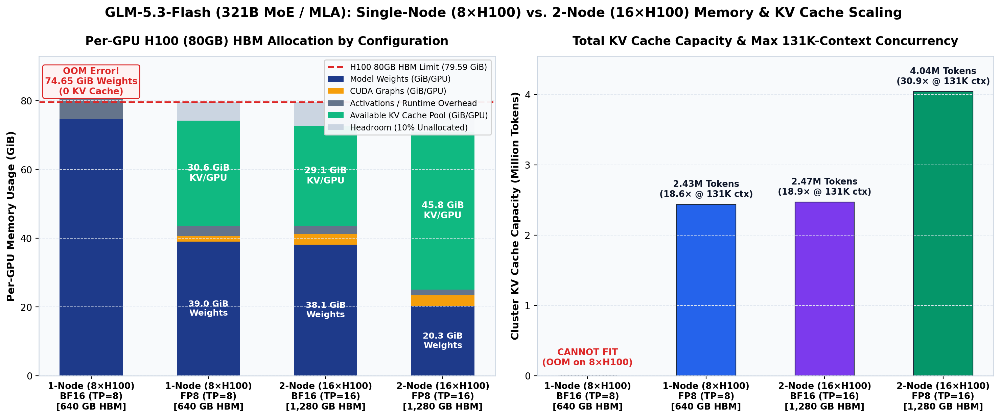
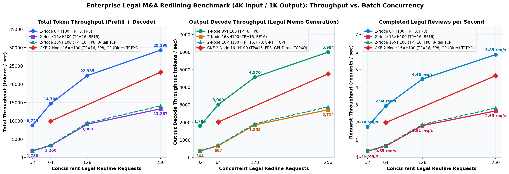
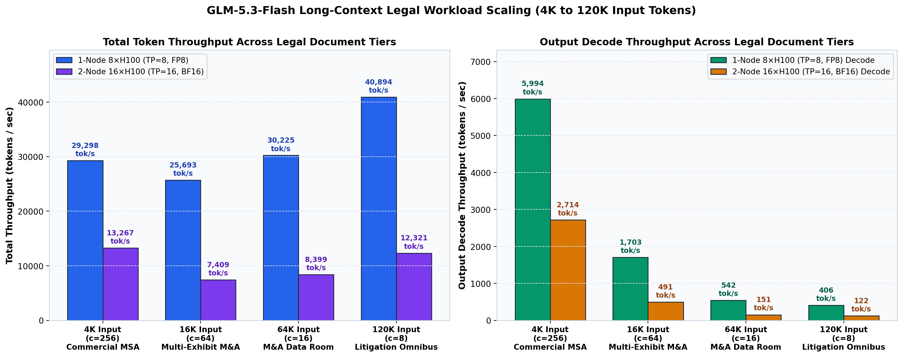
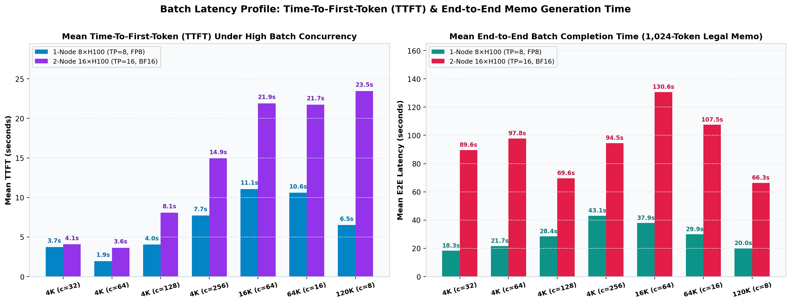
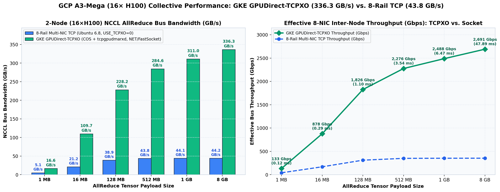

# GLM-5.3-Flash Serving on GCP A3-Mega (`a3-megagpu-8g`) with vLLM

Infrastructure provisioning, 8-NIC multi-rail networking, and vLLM throughput benchmarks for [`zai-org/GLM-5.3-Flash`](https://huggingface.co/zai-org/GLM-5.3-Flash) (FP8) and [`zai-org/GLM-5.3-Flash-BF16`](https://huggingface.co/zai-org/GLM-5.3-Flash-BF16) (BF16) on Google Cloud `a3-megagpu-8g` instances (`8× NVIDIA H100 80GB` per host).

* **Detailed Benchmark Report:** [`results/BENCHMARK_RESULTS.md`](results/BENCHMARK_RESULTS.md)
* **CSV Metrics Summary:** [`results/summary_metrics.csv`](results/summary_metrics.csv)
* **Multi-NIC & GCE MIG Setup Guide:** [`docs/NETWORKING_AND_MIG_GUIDE.md`](docs/NETWORKING_AND_MIG_GUIDE.md)
* **Kubernetes (GKE) + GPUDirect-TCPXO + Helm Guide:** [`k8s/README.md`](k8s/README.md)

---

## Best Serving Configuration

Across both Compute Engine (`infra/`) and GKE (`k8s/`), the highest-throughput configuration for `GLM-5.3-Flash` (`321.3B` total parameters, `~30B` active per token) on H100 hardware is **Single-Node `8× NVIDIA H100 80GB` (`TP=8`, FP8)**:

* **Hardware & Parallelism:** `1× a3-megagpu-8g` (`8× H100 80GB HBM3`, `TP=8`, `PP=1`), keeping all tensor-parallel collectives on intra-node `900 GB/s` NVSwitch NVLink with zero inter-node network overhead.
* **Model & Engine Flags:** `zai-org/GLM-5.3-Flash` (native FP8) with `--tensor-parallel-size 8 --max-model-len 131072 --max-num-seqs 256 --max-num-batched-tokens 8192 --gpu-memory-utilization 0.90 --tokenizer-mode glm5_next --no-numa-bind`.
* **Memory & KV Cache:** `39.02 GiB/GPU` weights + `1.54 GiB/GPU` CUDA graphs, leaving **`30.58 GiB/GPU` (`244.64 GiB` total = `2,434,451` tokens)** for KV cache (`18.57×` concurrency at `131,072` context length).
* **Benchmark Throughput (Synthetic Long-Context Dataset):**
  * **4K Input / 1K Output (`c=256`):** **`29,298.16 tok/s` total** (`23,303.72 tok/s` prefill + **`5,994.44 tok/s` output decode**, **`5.854 req/s`**).
  * **120K Input / 1K Output (`c=8`):** **`40,893.74 tok/s` total** (`40,488.01 tok/s` prefill + `405.72 tok/s` decode, `6.51s` mean TTFT).
* **When to Use 2-Node (`16× H100`, `TP=16` with GPUDirect-TCPXO):** Reserve 2-node `TP=16` for unquantized 16-bit **`zai-org/GLM-5.3-Flash-BF16`** (`609.12 GiB` weights, which exceeds single-node HBM) or when `>4M` token KV cache capacity (`733.44 GiB`) is required.

---

## 1. System Topology

```
┌─────────────────────────────────────────────────────────────────────────────────────────────────┐
│                   GCP Zone: us-west1-b | Machine Type: a3-megagpu-8g (Spot)                     │
│                  Zonal Managed Instance Group (MIG): glm-a3mega-mig                             │
├───────────────────────────────────────────────┬─────────────────────────────────────────────────┤
│   Node 0: glm-a3mega-mig-tw4q (a3-megagpu-8g) │   Node 1: glm-a3mega-mig-x5v7 (a3-megagpu-8g)   │
│   • 8× NVIDIA H100 80GB HBM3 (640 GB HBM)     │   • 8× NVIDIA H100 80GB HBM3 (640 GB HBM)       │
│   • NVSwitch 900 GB/s Intra-Node NVLink       │   • NVSwitch 900 GB/s Intra-Node NVLink         │
│   • 16×375 GB Local NVMe RAID-0 (5.9 TB)      │   • 16×375 GB Local NVMe RAID-0 (5.9 TB)        │
│   • nic0 (enp0s12): 10.138.0.94 (Mgmt VPC)    │   • nic0 (enp0s12): 10.138.0.87 (Mgmt VPC)      │
│   • nic1..nic8 (enp6s0f0..enp142s0f0):        │   • nic1..nic8 (enp6s0f0..enp142s0f0):          │
│     192.168.1.3 .. 192.168.8.3 (MTU 8244)     │     192.168.1.2 .. 192.168.8.2 (MTU 8244)       │
└───────────────────────┬───────────────────────┴────────────────────────┬────────────────────────┘
                        │     8× Dedicated GPU Data VPCs (MTU 8244)      │
                        └────────────► 43.79 GB/s NCCL BusBW ◄───────────┘
                                      (350.3 Gbps Multi-Rail)
```

### Configurations Tested

1. **Single-Node (`1 Host / 8× H100 80GB = 640 GB HBM`)**:
   - **BF16 (`zai-org/GLM-5.3-Flash-BF16`, `TP=8`)**: Model weights require `74.65 GiB` per GPU (`597.20 GiB` total), leaving insufficient HBM for forward activations and failing with `Cuda failure 2 'out of memory'` during warmup (`0 GiB` KV cache).
   - **FP8 (`zai-org/GLM-5.3-Flash`, `TP=8`)**: Model weights require `39.02 GiB` per GPU and CUDA graphs require `1.54 GiB` per GPU, leaving `30.58 GiB` per GPU (`244.64 GiB` total = `2,434,451` tokens) for KV cache (`18.57×` concurrency at `131,072` context length).
2. **Multi-Host (`2 Hosts / 16× H100 80GB = 1,280 GB HBM`)**:
   - **BF16 (`zai-org/GLM-5.3-Flash-BF16`, `TP=16`)**: Shards the 16-bit weights across 16 GPUs (`38.07 GiB` per GPU / `609.12 GiB` total), freeing `29.05 GiB` per GPU (`464.80 GiB` total = `2,470,799` tokens) for KV cache (`18.85×` concurrency at `131,072` context length).
   - **FP8 (`zai-org/GLM-5.3-Flash`, `TP=16`)**: Reduces weights to `20.27 GiB` per GPU (`324.32 GiB` total), expanding cluster KV cache capacity to `45.84 GiB` per GPU (`733.44 GiB` total = `4,043,663` tokens, `30.85×` concurrency at `131,072` context length).

---

## 2. Benchmark Results

### 2.1 Memory Footprint & KV Cache Capacity (`8×H100` vs. `16×H100`)



### 2.2 4K Legal M&A Redlining Throughput Scaling (`c=32, 64, 128, 256`)



### 2.3 Long-Context Legal Workload Scaling (`4K`, `16K`, `64K`, `120K` Input Tokens)



### 2.4 Batch Latency Profile (TTFT & End-to-End Turnaround Time)



### 2.5 2-Node (`16×H100`) 8-NIC Multi-Rail NCCL AllReduce Bandwidth



---

## 3. Summary Metrics Table

Benchmarks use a procedurally generated synthetic document dataset (`benchmarks/generate_legal_dataset.py`) with `4K`, `16K`, `64K`, and `120K` input tokens and `1,024` output tokens per request. While the synthetic text uses legal contract templates to produce structured multi-section outputs, the throughput and latency measurements depend only on input/output token shapes and apply to any workload with similar context lengths.

| Configuration | Model | Input Shape | Target Input (`Avg Prompt`) | Target Output | Concurrency | Input Prefill (`tok/s`) | Output Decode (`tok/s`) | **Total Throughput (`tok/s`)** | Request Rate (`req/s`) | Mean TTFT (`s`) | Mean E2E (`s`) |
| :--- | :--- | :--- | :---: | :---: | :---: | :---: | :---: | :---: | :---: | :---: | :---: |
| **1-Node `8×H100` (`TP=8`, FP8)** | `GLM-5.3-Flash` | **4K In / 1K Out** | `4,096` (`3,981`) | `1,024` | `c=32` | `6,943.31` | `1,785.91` | **`8,729.22`** | `1.744` | `3.73s` | `18.27s` |
| **1-Node `8×H100` (`TP=8`, FP8)** | `GLM-5.3-Flash` | **4K In / 1K Out** | `4,096` (`3,981`) | `1,024` | `c=64` | `11,697.51` | `3,008.57` | **`14,706.09`** | `2.938` | `1.94s` | `21.68s` |
| **1-Node `8×H100` (`TP=8`, FP8)** | `GLM-5.3-Flash` | **4K In / 1K Out** | `4,096` (`3,981`) | `1,024` | `c=128` | `17,765.31` | `4,569.75` | **`22,335.06`** | `4.463` | `4.04s` | `28.45s` |
| **1-Node `8×H100` (`TP=8`, FP8)** | `GLM-5.3-Flash` | **4K In / 1K Out** | `4,096` (`3,981`) | `1,024` | `c=256` | `23,303.72` | **`5,994.44`** | **`29,298.16`** | **`5.854`** | `7.73s` | `43.09s` |
| **1-Node `8×H100` (`TP=8`, FP8)** | `GLM-5.3-Flash` | **16K In / 1K Out** | `16,384` (`14,423`) | `1,024` | `c=64` | `23,989.44` | `1,703.24` | **`25,692.68`** | `1.663` | `11.06s` | `37.92s` |
| **1-Node `8×H100` (`TP=8`, FP8)** | `GLM-5.3-Flash` | **64K In / 1K Out** | `65,536` (`56,085`) | `1,024` | `c=16` | `29,682.58` | `541.94` | **`30,224.53`** | `0.529` | `10.60s` | `29.90s` |
| **1-Node `8×H100` (`TP=8`, FP8)** | `GLM-5.3-Flash` | **120K In / 1K Out** | `120,000` (`102,187`) | `1,024` | `c=8` | **`40,488.01`** | `405.72` | **`40,893.74`** | `0.396` | `6.51s` | `20.04s` |
| **2-Node `16×H100` (`TP=16`, BF16)** | `GLM-5.3-Flash-BF16` | **4K In / 1K Out** | `4,096` (`3,981`) | `1,024` | `c=32` | `1,415.91` | `364.19` | **`1,780.10`** | `0.356` | `4.07s` | `89.63s` |
| **2-Node `16×H100` (`TP=16`, BF16)** | `GLM-5.3-Flash-BF16` | **4K In / 1K Out** | `4,096` (`3,981`) | `1,024` | `c=64` | `2,593.42` | `667.02` | **`3,260.44`** | `0.651` | `3.64s` | `97.81s` |
| **2-Node `16×H100` (`TP=16`, BF16)** | `GLM-5.3-Flash-BF16` | **4K In / 1K Out** | `4,096` (`3,981`) | `1,024` | `c=128` | `7,212.79` | `1,855.34` | **`9,068.13`** | `1.812` | `8.09s` | `69.63s` |
| **2-Node `16×H100` (`TP=16`, BF16)** | `GLM-5.3-Flash-BF16` | **4K In / 1K Out** | `4,096` (`3,981`) | `1,024` | `c=256` | `10,552.22` | **`2,714.36`** | **`13,266.58`** | **`2.651`** | `14.94s` | `94.46s` |
| **2-Node `16×H100` (`TP=16`, BF16)** | `GLM-5.3-Flash-BF16` | **16K In / 1K Out** | `16,384` (`14,423`) | `1,024` | `c=64` | `6,918.23` | `491.19` | **`7,409.42`** | `0.480` | `21.89s` | `130.64s` |
| **2-Node `16×H100` (`TP=16`, BF16)** | `GLM-5.3-Flash-BF16` | **64K In / 1K Out** | `65,536` (`56,085`) | `1,024` | `c=16` | `8,248.20` | `150.60` | **`8,398.80`** | `0.147` | `21.75s` | `107.52s` |
| **2-Node `16×H100` (`TP=16`, BF16)** | `GLM-5.3-Flash-BF16` | **120K In / 1K Out** | `120,000` (`102,187`) | `1,024` | `c=8` | **`12,198.90`** | `122.24` | **`12,321.14`** | `0.119` | `23.46s` | `66.33s` |
| **2-Node `16×H100` (`TP=16`, FP8)** | `GLM-5.3-Flash` | **4K In / 1K Out** | `4,096` (`3,981`) | `1,024` | `c=32` | `1,480.89` | `380.90` | **`1,861.79`** | `0.372` | `3.98s` | `85.69s` |
| **2-Node `16×H100` (`TP=16`, FP8)** | `GLM-5.3-Flash` | **4K In / 1K Out** | `4,096` (`3,981`) | `1,024` | `c=64` | `2,679.43` | `689.14` | **`3,368.58`** | `0.673` | `4.31s` | `94.62s` |
| **2-Node `16×H100` (`TP=16`, FP8)** | `GLM-5.3-Flash` | **4K In / 1K Out** | `4,096` (`3,981`) | `1,024` | `c=128` | `7,462.10` | `1,919.47` | **`9,381.57`** | `1.874` | `8.77s` | `67.32s` |
| **2-Node `16×H100` (`TP=16`, FP8)** | `GLM-5.3-Flash` | **4K In / 1K Out** | `4,096` (`3,981`) | `1,024` | `c=256` | `11,190.08` | **`2,878.43`** | **`14,068.51`** | **`2.811`** | `16.45s` | `89.11s` |
| **2-Node `16×H100` (`TP=16`, FP8)** | `GLM-5.3-Flash` | **120K In / 1K Out** | `120,000` (`102,187`) | `1,024` | `c=8` | `8,142.34` | `81.59` | **`8,223.94`** | `0.080` | `41.15s` | `99.55s` |
| **GKE 1-Node `8×H100` (`TP=8`, FP8)** | `GLM-5.3-Flash` | **4K In / 1K Out** | `4,096` (`3,981`) | `1,024` | `c=64` | `10,780.60` | `2,772.74` | **`13,553.34`** | `2.708` | `3.76s` | `23.43s` |
| **GKE 1-Node `8×H100` (`TP=8`, FP8)** | `GLM-5.3-Flash` | **4K In / 1K Out** | `4,096` (`3,981`) | `1,024` | `c=256` | `19,506.95` | **`5,017.79`** | **`24,524.75`** | **`4.900`** | `11.40s` | `51.30s` |
| **GKE 1-Node `8×H100` (`TP=8`, FP8)** | `GLM-5.3-Flash` | **120K In / 1K Out** | `120,000` (`102,187`) | `1,024` | `c=8` | **`25,014.45`** | `250.67` | **`25,265.12`** | `0.245` | `13.76s` | `32.37s` |
| **GKE 2-Node `16×H100` (`TP=16`, FP8, TCPXO)** | `GLM-5.3-Flash` | **4K In / 1K Out** | `4,096` (`3,981`) | `1,024` | `c=64` | `7,903.79` | `2,016.89` | **`9,920.68`** | `1.985` | `6.13s` | `31.78s` |
| **GKE 2-Node `16×H100` (`TP=16`, FP8, TCPXO)** | `GLM-5.3-Flash` | **4K In / 1K Out** | `4,096` (`3,981`) | `1,024` | `c=256` | `18,526.31` | **`4,756.05`** | **`23,282.36`** | **`4.654`** | `11.32s` | `53.87s` |
| **GKE 2-Node `16×H100` (`TP=16`, FP8, TCPXO)** | `GLM-5.3-Flash` | **120K In / 1K Out** | `120,000` (`102,187`) | `1,024` | `c=8` | **`19,511.51`** | `195.52` | **`19,707.03`** | `0.191` | `14.27s` | `41.25s` |

---

## 4. Repository Layout

```text
glm-serving/
├── LICENSE                            # Apache 2.0 License
├── README.md                          # Overview, architecture, and quickstart
├── docs/
│   └── NETWORKING_AND_MIG_GUIDE.md    # 9-NIC VPC setup, Spot MIG, NVMe RAID-0, and NCCL multi-rail guide
├── infra/
│   ├── provision_a3_mega_mig.sh       # Provisions 8 GPU VPCs (MTU 8244), instance template, and Spot MIG
│   ├── teardown_a3_mega_mig.sh        # Deletes Spot MIG while keeping VPC networks by default
│   ├── bootstrap_node.sh              # Assembles 16x NVMe RAID-0 (/mnt/localssd), configures Docker & sysctl
│   ├── setup_tcpxo.sh                 # Optional GPUDirect-TCPXO / Fastrak plugin & RxDM installer
│   └── nodes_inventory.json           # Reference node topology and multi-NIC IP allocation
├── serving/
│   ├── download_models.py             # Multi-worker checkpoint downloader (HF_HUB_ENABLE_HF_TRANSFER=1)
│   ├── serve_single_node.sh           # Single-Node (8x H100, TP=8) vLLM launch script
│   └── serve_multi_node.sh            # Multi-Node (2x8=16x H100, TP=16 / TP=8,PP=2) vLLM launch script
├── benchmarks/
│   ├── generate_legal_dataset.py      # M&A due diligence & litigation discovery prompt generator
│   ├── legal_benchmark.py             # Async OpenAI streaming throughput & latency benchmark client
│   └── generate_charts.py             # Aggregates results/*.json into summary_metrics.csv and PNG charts
├── datasets/                          # Generated legal JSONL prompt sets (4K, 16K, 64K, 128K)
├── k8s/                               # GKE cluster scripts, GPUDirect-TCPXO DaemonSets, and Helm chart
│   ├── README.md                      # GKE + GPUDirect-TCPXO + Helm deployment and benchmark guide
│   ├── scripts/                       # GKE cluster provisioning, benchmark runner, and teardown scripts
│   ├── manifests/                     # Multi-networking CRDs, TCPXO installer, and NRI injector manifests
│   └── helm/glm-vllm-benchmark/       # Helm chart for 1-node (TP=8) and 2-node (TP=16 TCPXO) benchmarks
└── results/
    ├── BENCHMARK_RESULTS.md           # Full technical benchmark report and sample legal outputs
    ├── summary_metrics.csv            # Consolidated metrics across all 19 benchmark runs
    ├── charts/                        # Benchmark visualizations (*.png)
    └── *.json                         # Raw per-run JSON metrics
```

---

## 5. Reproduction Steps

### Step 1: Provision the 2-Node A3-Mega Spot MIG (`16× H100 80GB`)
```bash
bash infra/provision_a3_mega_mig.sh
```
See [`docs/NETWORKING_AND_MIG_GUIDE.md`](docs/NETWORKING_AND_MIG_GUIDE.md) for full details on the 9-NIC VPC layout and multi-rail verification.

### Step 2: Bootstrap Local NVMe RAID-0 & Download Models on Each Node
```bash
bash infra/bootstrap_node.sh
python3 serving/download_models.py --model zai-org/GLM-5.3-Flash
python3 serving/download_models.py --model zai-org/GLM-5.3-Flash-BF16
```

### Step 3: Run Configuration 1 — Single-Node (`8× H100`, `TP=8`, FP8)
```bash
MODEL=zai-org/GLM-5.3-Flash STRATEGY=tp8 MAX_MODEL_LEN=131072 MAX_NUM_BATCHED_TOKENS=8192 bash serving/serve_single_node.sh
```

### Step 4: Run Configuration 2 — Multi-Host (`2-Node / 16× H100`, `TP=16`, BF16 or FP8)
```bash
# On Node 1 (Worker, headless):
NODE_RANK=1 HEAD_IP=192.168.1.3 MODEL=zai-org/GLM-5.3-Flash-BF16 STRATEGY=tp16 MAX_MODEL_LEN=131072 MAX_NUM_BATCHED_TOKENS=8192 USE_TCPXO=0 bash serving/serve_multi_node.sh

# On Node 0 (Head + API Server):
NODE_RANK=0 HEAD_IP=192.168.1.3 MODEL=zai-org/GLM-5.3-Flash-BF16 STRATEGY=tp16 MAX_MODEL_LEN=131072 MAX_NUM_BATCHED_TOKENS=8192 USE_TCPXO=0 bash serving/serve_multi_node.sh
```

### Step 5: Execute the Legal Throughput Benchmark & Regenerate Charts
```bash
sudo docker exec vllm-server python3 /tmp/legal_benchmark.py \
  --base-url http://localhost:8000 \
  --model zai-org/GLM-5.3-Flash \
  --config-name "single_node_8xH100_tp8_fp8_c256_4k" \
  --num-prompts 256 \
  --concurrency 256 \
  --input-tokens 4096 \
  --output-tokens 1024 \
  --output-json /tmp/results/single_node_tp8_fp8_c256_4k.json

uv run --with matplotlib --with numpy python3 benchmarks/generate_charts.py
```

### Step 6: Tear Down the Spot MIG (Preserving VPC Networks)
```bash
bash infra/teardown_a3_mega_mig.sh
```

---

## 6. License

Licensed under the Apache License, Version 2.0. See [`LICENSE`](LICENSE) for details.
