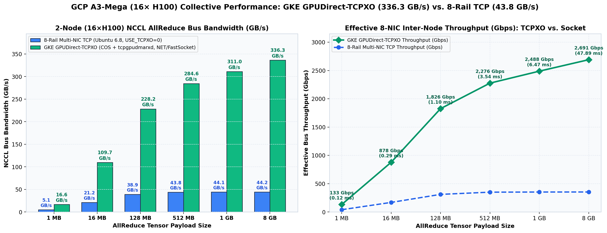

# GLM-5.3-Flash on GKE (`a3-megagpu-8g`) with GPUDirect-TCPXO & Helm

This directory contains the Google Kubernetes Engine (GKE) provisioning scripts, Multi-Networking & GPUDirect-TCPXO system manifests, and a Helm chart ([`helm/glm-vllm-benchmark`](helm/glm-vllm-benchmark)) to deploy and benchmark [`zai-org/GLM-5.3-Flash`](https://huggingface.co/zai-org/GLM-5.3-Flash) (`321.3B` FP8) and [`zai-org/GLM-5.3-Flash-BF16`](https://huggingface.co/zai-org/GLM-5.3-Flash-BF16) (`321.3B` BF16) across Single-Node (`8× H100`) and Multi-Host (`2-Node / 16× H100`) Spot `a3-megagpu-8g` node pools.

---

## 1. GKE GPUDirect-TCPXO Architecture

Unlike standard Ubuntu 22.04 `6.8` VM images where the `tcpgpudmarxd` Receive Data Path Manager cannot initialize `dmabuf` page pools without the `import-helper` kernel module, GKE Standard GPU node pools run **Container-Optimized OS (`COS_CONTAINERD`)**, which includes native kernel support for Google's GPUDirect-TCPXO (`import-helper` / `/dev/dmabuf_import_helper` and PCIe `1ae0:0084` aperture devices).

```
┌─────────────────────────────────────────────────────────────────────────────────────────────────┐
│             GKE Standard Cluster: glm-a3mega-gke (us-west1-b, Dataplane V2 + Multi-Net)         │
├───────────────────────────────────────────────┬─────────────────────────────────────────────────┤
│  GKE Node 0 (a3-megagpu-8g Spot, COS)         │  GKE Node 1 (a3-megagpu-8g Spot, COS)           │
│  • DaemonSet: nccl-tcpxo-installer            │  • DaemonSet: nccl-tcpxo-installer              │
│    - modprobe import-helper                   │    - modprobe import-helper                     │
│    - mounts /dev/aperture_devices (1ae0:0084) │    - mounts /dev/aperture_devices (1ae0:0084)   │
│    - installs libnccl-net.so & tuner plugin   │    - installs libnccl-net.so & tuner plugin     │
│  • DaemonSet: device-injector (NRI)           │  • DaemonSet: device-injector (NRI)             │
│  ┌─────────────────────────────────────────┐  │  ┌───────────────────────────────────────────┐  │
│  │ Pod: glm-vllm-bench (Head + Benchmark)  │  │  │ Pod: glm-vllm-worker-0 (Headless Worker)  │  │
│  │ • Sidecar: tcpxo-daemon (tcpgpudmarxd)  │  │  │ • Sidecar: tcpxo-daemon (tcpgpudmarxd)    │  │
│  │ • Container: vllm-head-and-bench (8 GPU)│  │  │ • Container: vllm-worker (8 GPU)          │  │
│  │ • NICs: eth0 (default) + eth1..8 (vpc1..8) │  │ • NICs: eth0 (default) + eth1..8 (vpc1..8)│  │
│  └────────────────────┬────────────────────┘  │  └─────────────────────┬─────────────────────┘  │
└───────────────────────┼───────────────────────┴────────────────────────┼────────────────────────┘
                        │       8× NetDevice Passthrough VPCs (MTU 8244) │
                        └──────────► GPUDirect-TCPXO (NET/FastSocket) ◄──┘
```

### How GPUDirect-TCPXO is Configured in GKE Pods

1. **GKE Multi-Networking CRDs ([`manifests/multinetwork-networks.yaml`](manifests/multinetwork-networks.yaml))**:
   Registers 8 `GKENetworkParamSet` (`deviceMode: NetDevice`) and `Network` (`type: Device`) objects (`vpc1` .. `vpc8`) mapped to the 8 `MTU 8244` VPC networks (`glm-a3mega-net-1..8` / `glm-a3mega-sub-1..8`).
2. **GPUDirect-TCPXO Installer DaemonSet ([`manifests/nccl-tcpxo-installer.yaml`](manifests/nccl-tcpxo-installer.yaml))**:
   Runs on every `nvidia-h100-mega-80gb` node to load the `import-helper` kernel module, bind-mount PCIe `1ae0:0084` aperture devices under `/dev/aperture_devices`, and install `libnccl-net.so`, `libnccl-tuner.so`, `a3plus_tuner_config.textproto`, and `nccl-env-profile.sh` into `/home/kubernetes/bin/nvidia/lib64`.
3. **NRI Device Injector DaemonSet ([`manifests/nri-device-injector.yaml`](manifests/nri-device-injector.yaml))**:
   Injects `/dev/nvidia0..7`, `/dev/nvidiactl`, `/dev/nvidia-uvm`, and `/dev/dmabuf_import_helper` into the `tcpxo-daemon` sidecar via the `devices.gke.io/container.tcpxo-daemon` Pod annotation.
4. **Native Sidecar Lifecycle (`restartPolicy: Always`)**:
   Both the Head Job Pod ([`templates/job-benchmark.yaml`](helm/glm-vllm-benchmark/templates/job-benchmark.yaml)) and Worker StatefulSet Pod ([`templates/statefulset-worker.yaml`](helm/glm-vllm-benchmark/templates/statefulset-worker.yaml)) run `tcpxo-daemon` (`tcpgpudmarxd-dev:v1.0.23`) as a native Kubernetes sidecar (`initContainers` with `restartPolicy: Always` and `startupProbe` on `fastrak_gpumem_manager`) so the sidecar starts before `vllm` and terminates automatically when the benchmark Job finishes.

---

## 2. Measured GKE GPUDirect-TCPXO Collective Bandwidth (`16× H100`)

Executed via [`manifests/nccl-tcpxo-test.yaml`](manifests/nccl-tcpxo-test.yaml) across `gke-glm-a3mega-gke-a3-mega-spot-pool` (`2× a3-megagpu-8g` = `16× H100 80GB`) with `tcpgpudmarxd-dev:v1.0.23` and `nccl-plugin-gpudirecttcpx-dev:v1.0.17` (raw logs saved in [`../results/gke_nccl_tcpxo_allreduce_perf.txt`](../results/gke_nccl_tcpxo_allreduce_perf.txt) and [`../results/gke_nccl_tcpxo_allgather_perf.txt`](../results/gke_nccl_tcpxo_allgather_perf.txt)):

| Payload Size | 8-Rail Socket BusBW (`USE_TCPXO=0`) | **GKE GPUDirect-TCPXO `all_reduce_perf` (`us` / AlgBW / BusBW)** | **GKE GPUDirect-TCPXO `all_gather_perf` (`us` / AlgBW / BusBW)** | Speedup vs. 8-Rail TCP |
| :---: | :---: | :---: | :---: | :---: |
| **`1 MB`** | `5.09 GB/s` (`360 us`) | `118.3 us` / `8.86 GB/s` / **`16.62 GB/s` (`133.0 Gbps`)** | `146.3 us` / `7.17 GB/s` / **`6.72 GB/s`** | **`3.27×`** |
| **`16 MB`** | `21.17 GB/s` (`1,380 us`) | `286.7 us` / `58.51 GB/s` / **`109.72 GB/s` (`877.8 Gbps`)** | `229.2 us` / `73.21 GB/s` / **`68.63 GB/s`** | **`5.18×`** |
| **`128 MB`** | `38.91 GB/s` (`6,020 us`) | `1,102.8 us` / `121.71 GB/s` / **`228.21 GB/s` (`1,825.7 Gbps`)** | `818.6 us` / `163.96 GB/s` / **`153.72 GB/s`** | **`5.86×`** |
| **`512 MB`** | `43.79 GB/s` (`21,410 us`) | `3,537.7 us` / `151.76 GB/s` / **`284.55 GB/s` (`2,276.4 Gbps`)** | `2,916.7 us` / `184.07 GB/s` / **`172.56 GB/s`** | **`6.50×`** |
| **`1 GB`** | `44.10 GB/s` | `6,473.3 us` / `165.87 GB/s` / **`311.01 GB/s` (`2,488.1 Gbps`)** | `5,522.6 us` / `194.43 GB/s` / **`182.28 GB/s`** | **`7.05×`** |
| **`4 GB`** | `44.20 GB/s` | `24,414.5 us` / `175.92 GB/s` / **`329.85 GB/s` (`2,638.8 Gbps`)** | `21,474.2 us` / `200.01 GB/s` / **`187.51 GB/s`** | **`7.46×`** |
| **`8 GB`** | `44.20 GB/s` | `47,888.6 us` / `179.37 GB/s` / **`336.32 GB/s` (`2,690.6 Gbps`)** | `42,733.1 us` / `201.01 GB/s` / **`188.45 GB/s`** | **`7.61×`** |



### GKE vLLM Throughput Results (`Single-Node TP=8` & `2-Node TP=16 GPUDirect-TCPXO`)

By eliminating CPU/host-memory staging across the 184 per-step `TP=16` `AllReduce` collectives (`92` MoE layers × `2` collectives/layer), GKE GPUDirect-TCPXO (`NET/FastSocket`) delivers **`1.65×` to `2.95×` higher 2-node `TP=16` vLLM throughput** than 8-rail multi-NIC TCP (`USE_TCPXO=0`), narrowing the gap between 2-node `TP=16` and single-node intra-NVSwitch `TP=8` to within **5.3%** at `c=256`:

| GKE Helm Configuration | Input Shape (`zai-org/GLM-5.3-Flash`) | Concurrency | Input Prefill (`tok/s`) | Output Decode (`tok/s`) | **Total Throughput (`tok/s`)** | Request Rate (`req/s`) | Mean TTFT (`s`) | Mean E2E (`s`) | Speedup vs. 8-Rail TCP (`TP=16`) |
| :--- | :--- | :---: | :---: | :---: | :---: | :---: | :---: | :---: | :---: |
| **GKE 1-Node `8×H100` (`TP=8`, FP8)** | **4K In / 1K Out** | `c=64` | `10,780.60` | `2,772.74` | **`13,553.34`** | `2.708` | `3.76s` | `23.43s` | Intra-Node NVSwitch Baseline |
| **GKE 1-Node `8×H100` (`TP=8`, FP8)** | **4K In / 1K Out** | `c=256` | `19,506.95` | **`5,017.79`** | **`24,524.75`** | **`4.900`** | `11.40s` | `51.30s` | Intra-Node NVSwitch Baseline |
| **GKE 1-Node `8×H100` (`TP=8`, FP8)** | **120K In / 1K Out** | `c=8` | **`25,014.45`** | `250.67` | **`25,265.12`** | `0.245` | `13.76s` | `32.37s` | Intra-Node NVSwitch Baseline |
| **GKE 2-Node `16×H100` (`TP=16`, FP8, TCPXO)** | **4K In / 1K Out** | `c=64` | `7,903.79` | `2,016.89` | **`9,920.68`** | `1.985` | `6.13s` | `31.78s` | **`2.95×` vs. 8-Rail TCP (`3,368.58 tok/s`)** |
| **GKE 2-Node `16×H100` (`TP=16`, FP8, TCPXO)** | **4K In / 1K Out** | `c=256` | `18,526.31` | **`4,756.05`** | **`23,282.36`** | **`4.654`** | `11.32s` | `53.87s` | **`1.65×` vs. 8-Rail TCP (`14,068.51 tok/s`)** |
| **GKE 2-Node `16×H100` (`TP=16`, FP8, TCPXO)** | **120K In / 1K Out** | `c=8` | **`19,511.51`** | `195.52` | **`19,707.03`** | `0.191` | `14.27s` | `41.25s` | **`2.40×` vs. 8-Rail TCP (`8,223.94 tok/s`)** |

---

## 3. Directory Structure

```text
k8s/
├── README.md                                  # GKE + GPUDirect-TCPXO + Helm documentation
├── scripts/
│   ├── provision_gke_cluster.sh               # Creates GKE cluster, 2x Spot a3-megagpu-8g pool, & TCPXO DaemonSets
│   ├── run_gke_benchmarks.sh                  # Runs Helm benchmark jobs and extracts JSON metrics to ../results/
│   └── teardown_gke_cluster.sh                # Deletes GKE cluster while keeping the 8 GPU VPC networks
├── manifests/
│   ├── multinetwork-networks.yaml             # 8x GKENetworkParamSet + Network CRDs (vpc1..vpc8)
│   ├── nccl-tcpxo-installer.yaml              # GPUDirect-TCPXO plugin & aperture device installer DaemonSet
│   ├── nri-device-injector.yaml               # NRI device injector DaemonSet for /dev/dmabuf_import_helper
│   └── nccl-tcpxo-test.yaml                   # Standalone 2-node (16-GPU) MPI all_reduce_perf / all_gather_perf pods
└── helm/
    └── glm-vllm-benchmark/
        ├── Chart.yaml                         # Helm chart definition
        ├── values.yaml                        # Default configuration
        ├── values-single-node-fp8.yaml        # Config 1: 1-Node 8xH100 (TP=8, FP8)
        ├── values-multi-node-bf16.yaml        # Config 2A: 2-Node 16xH100 (TP=16, BF16, GPUDirect-TCPXO)
        ├── values-multi-node-fp8.yaml         # Config 2B: 2-Node 16xH100 (TP=16, FP8, GPUDirect-TCPXO)
        ├── files/                             # Bundled Python scripts mounted via ConfigMap
        │   ├── download_models.py
        │   ├── generate_legal_dataset.py
        │   ├── legal_benchmark.py
        │   └── nccl_tcpxo_precheck.py
        └── templates/
            ├── configmap-scripts.yaml         # ConfigMap containing benchmark & precheck scripts
            ├── service-headless.yaml          # Headless Service for Node 0 / Node 1 DNS resolution
            ├── statefulset-worker.yaml        # Node 1 (--headless) worker with tcpxo-daemon sidecar
            └── job-benchmark.yaml             # Node 0 Head + Benchmark Job with tcpxo-daemon sidecar
```

---

## 3. Step-by-Step Usage

### Step 1: Provision the GKE Cluster & 2-Node Spot `a3-megagpu-8g` Pool

Run [`scripts/provision_gke_cluster.sh`](scripts/provision_gke_cluster.sh) (uses the active `gcloud config get-value project` automatically, or override via `PROJECT_ID` / `ZONE` / `NUM_GPU_NODES`):

```bash
ZONE=us-west1-b NUM_GPU_NODES=2 bash k8s/scripts/provision_gke_cluster.sh
```

This script:
1. Verifies the 8 `MTU 8244` GPU VPC networks (`glm-a3mega-net-1..8`) and subnets (`glm-a3mega-sub-1..8`) exist.
2. Creates the GKE Standard cluster `glm-a3mega-gke` with `--enable-dataplane-v2`, `--enable-ip-alias`, and `--enable-multi-networking`.
3. Creates the Spot GPU node pool `a3-mega-spot-pool` (`2× a3-megagpu-8g` = `16× H100 80GB`, `--ephemeral-storage-local-ssd count=16` for 5.9 TB NVMe storage per node, and 8 `--additional-node-network` attachments).
4. Applies [`manifests/multinetwork-networks.yaml`](manifests/multinetwork-networks.yaml), [`manifests/nccl-tcpxo-installer.yaml`](manifests/nccl-tcpxo-installer.yaml), and [`manifests/nri-device-injector.yaml`](manifests/nri-device-injector.yaml).

### Step 2: Run the vLLM Legal Benchmarks via Helm

You can run both Single-Node (`TP=8`, FP8) and Multi-Node (`TP=16`, BF16 over GPUDirect-TCPXO) benchmarks automatically via [`scripts/run_gke_benchmarks.sh`](scripts/run_gke_benchmarks.sh):

```bash
# Run both Single-Node FP8 and 2-Node BF16 (GPUDirect-TCPXO) benchmarks:
MODE=all bash k8s/scripts/run_gke_benchmarks.sh
```

Or deploy individual configurations directly with `helm install`:

```bash
# Option A: Single-Node (8x H100, TP=8, zai-org/GLM-5.3-Flash FP8)
helm install glm-vllm k8s/helm/glm-vllm-benchmark \
  -f k8s/helm/glm-vllm-benchmark/values-single-node-fp8.yaml

# Option B: Multi-Node (2x8=16x H100, TP=16, zai-org/GLM-5.3-Flash-BF16 with GPUDirect-TCPXO)
helm install glm-vllm k8s/helm/glm-vllm-benchmark \
  -f k8s/helm/glm-vllm-benchmark/values-multi-node-bf16.yaml

# Option C: Multi-Node (2x8=16x H100, TP=16, zai-org/GLM-5.3-Flash FP8 with GPUDirect-TCPXO)
helm install glm-vllm k8s/helm/glm-vllm-benchmark \
  -f k8s/helm/glm-vllm-benchmark/values-multi-node-fp8.yaml
```

Monitor the benchmark job progress:
```bash
kubectl logs -f job/glm-vllm-bench -c vllm-head-and-bench
```

### Step 3: Tear Down the GKE Cluster (Preserving VPC Networks)

```bash
bash k8s/scripts/teardown_gke_cluster.sh
```
